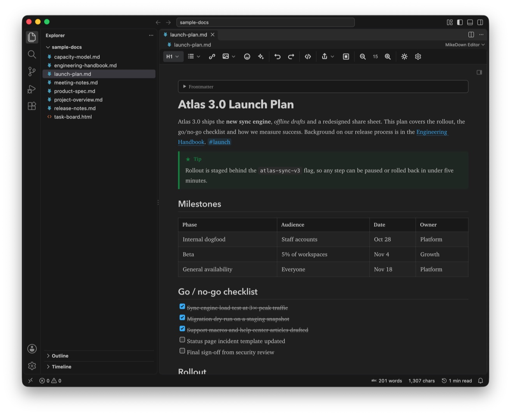
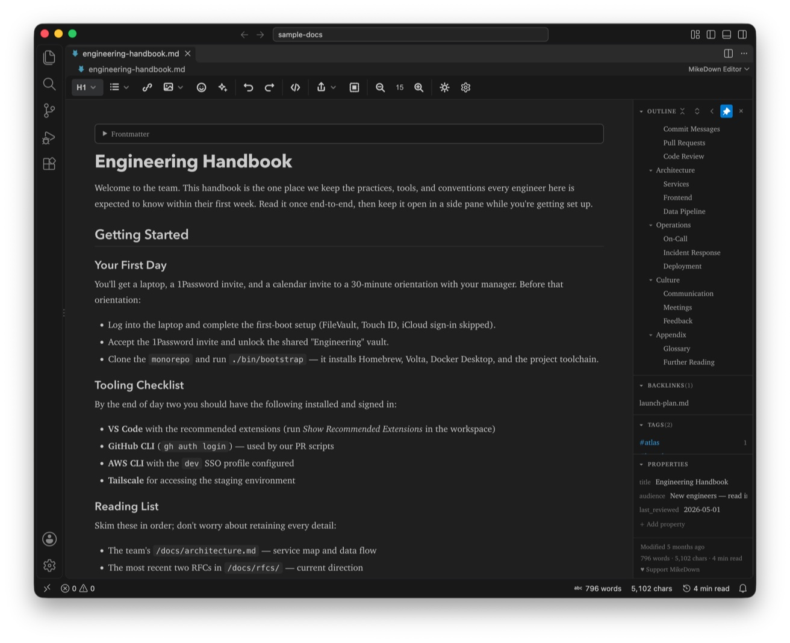
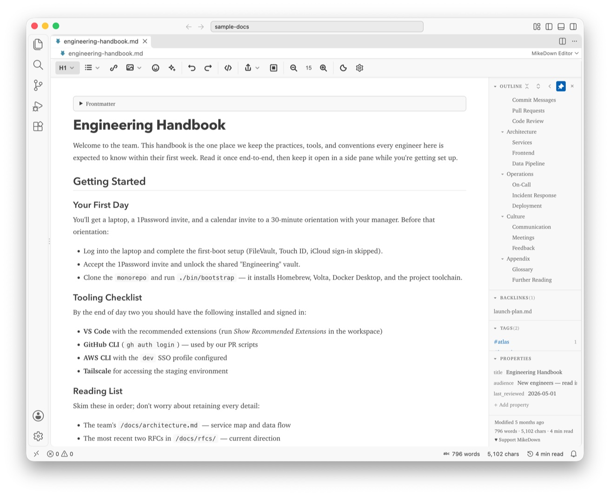
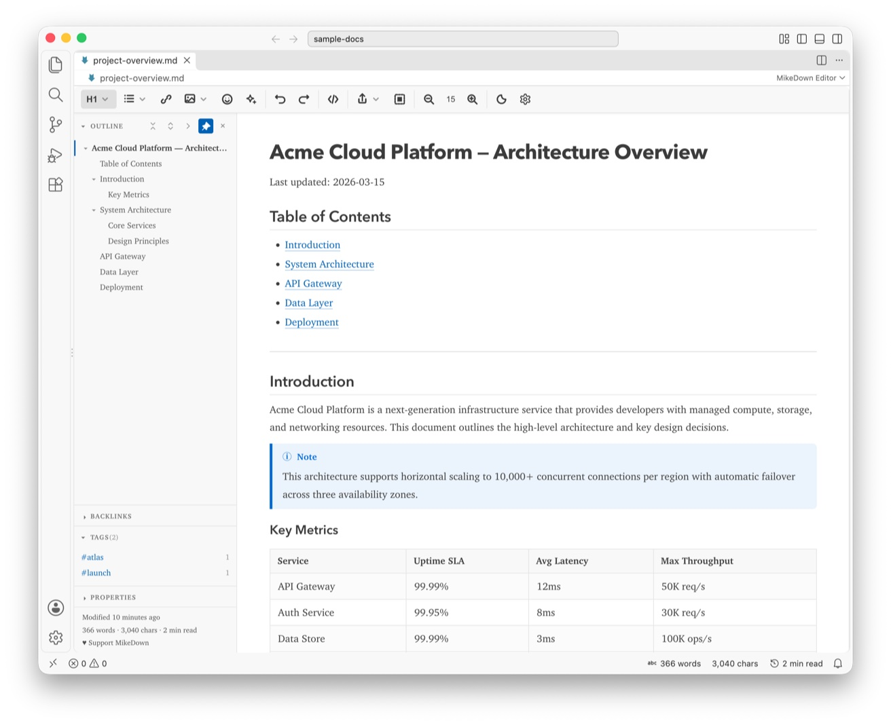
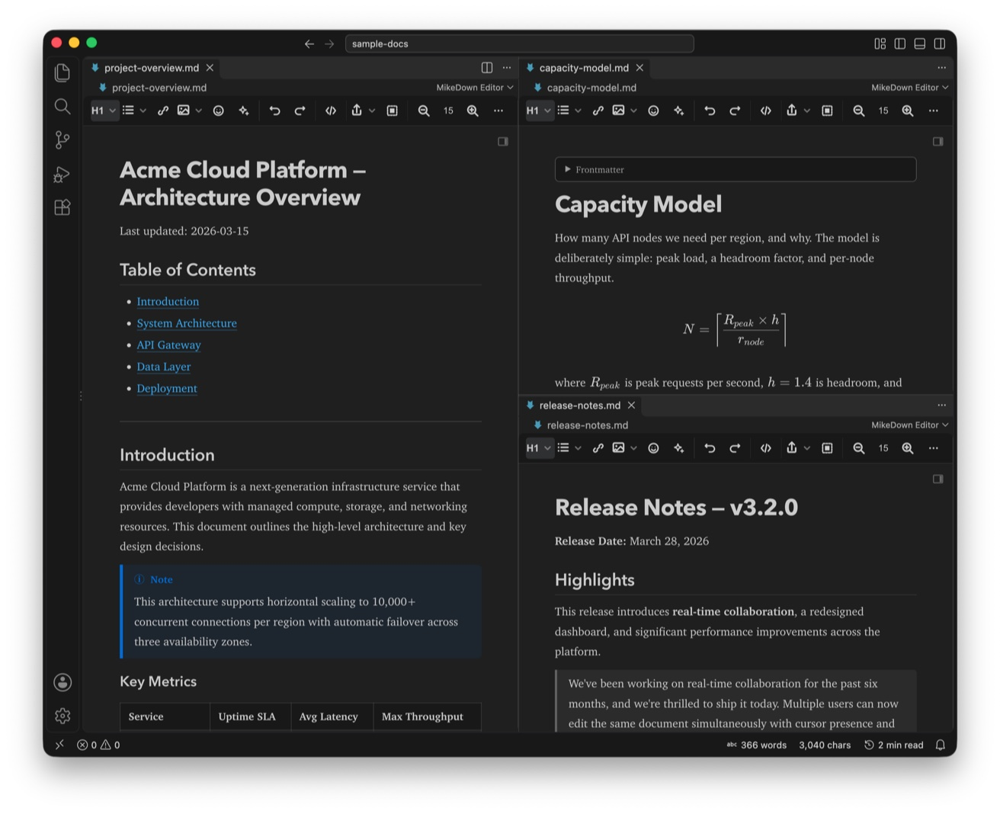
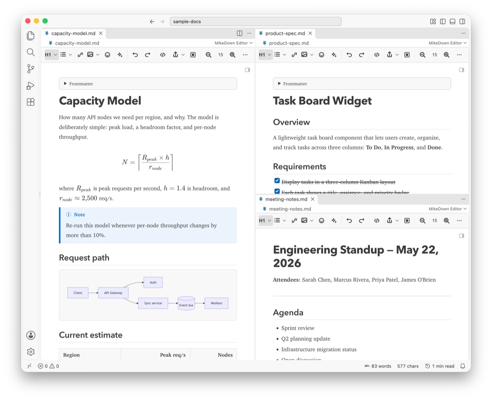
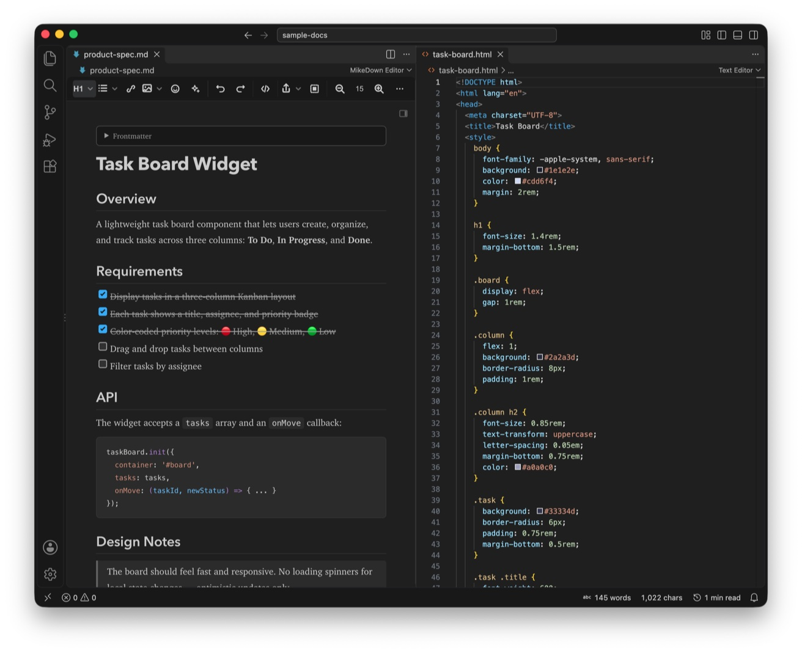
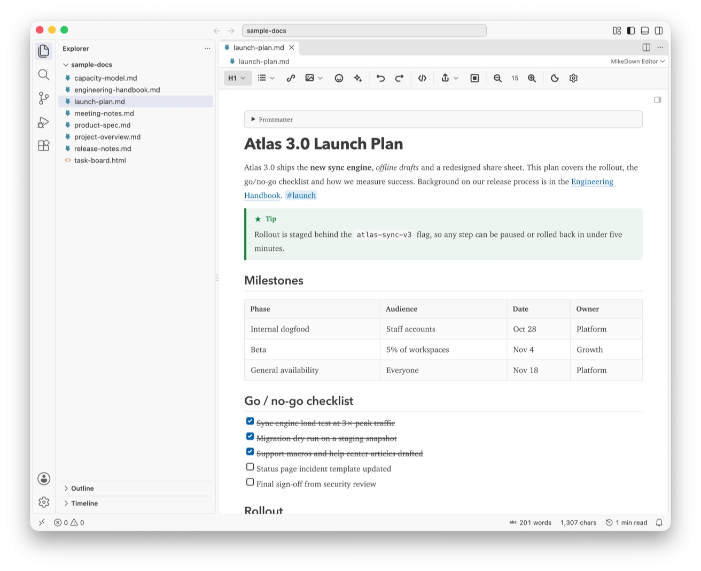
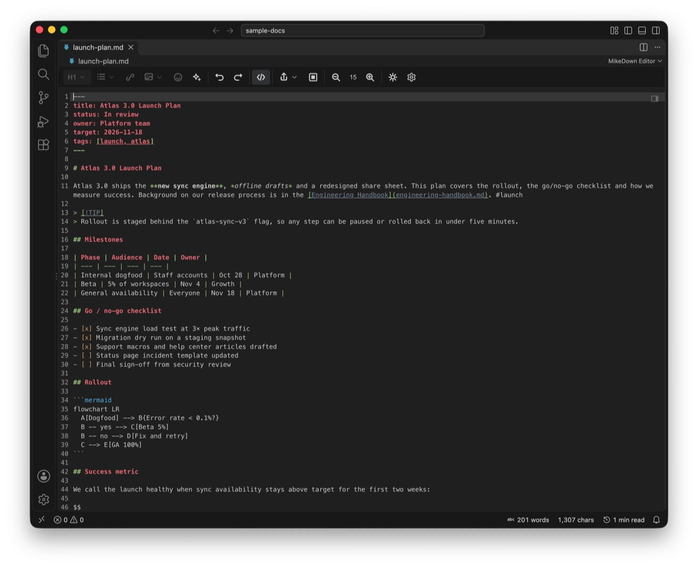
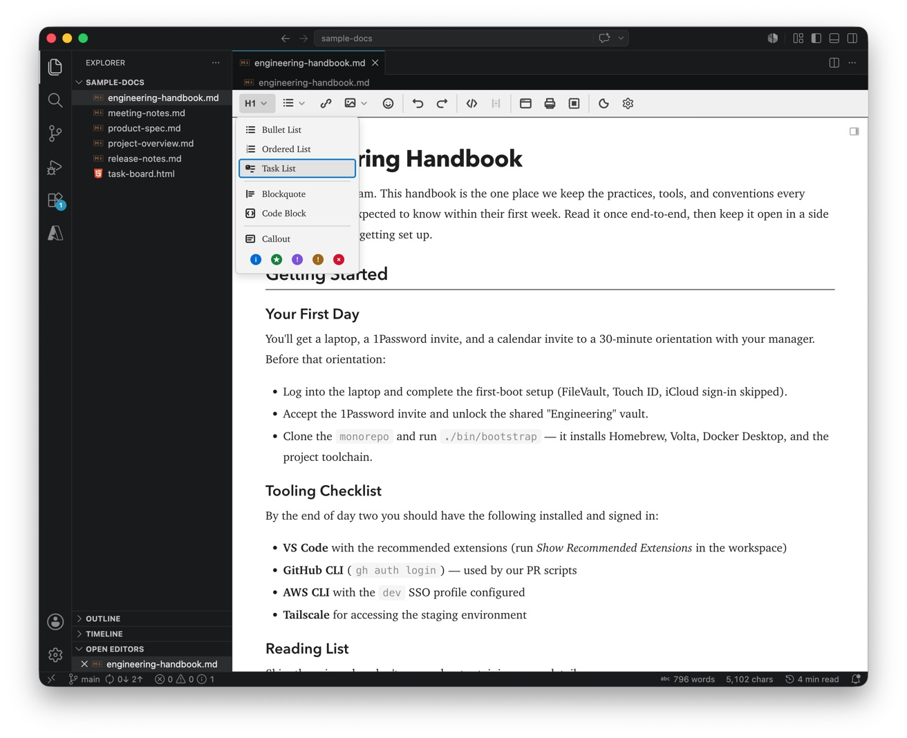

# MikeDown Editor

**A true WYSIWYG Markdown editor for VS Code — edit markdown visually, right in your editor tabs.**



## More MikeDown

[](https://www.npmjs.com/package/@mikedown/core)

- [MikeDown Desktop](https://www.iadev.net/mikedown/), the same editor as a standalone app.
- [MikeDown for VS Code](https://www.iadev.net/mikedown/vscode/), screenshots and features on the web.
- [Developers hub](https://www.iadev.net/mikedown/developers/), to embed the editor in your own app, with a live demo for each package:
  - [`@mikedown/core`](https://www.npmjs.com/package/@mikedown/core), the framework-agnostic editor.
  - [`@mikedown/web-component`](https://www.npmjs.com/package/@mikedown/web-component) ([demo](https://www.iadev.net/mikedown/developers/web-component/)), `<mikedown-editor>` for plain HTML, CDN pages and server-rendered templates.
  - [`@mikedown/react`](https://www.npmjs.com/package/@mikedown/react) ([demo](https://www.iadev.net/mikedown/developers/react/)), a React component.
  - [`@mikedown/vue`](https://www.npmjs.com/package/@mikedown/vue) ([demo](https://www.iadev.net/mikedown/developers/vue/)), a Vue 3 component with `v-model`.
  - [`@mikedown/angular`](https://www.npmjs.com/package/@mikedown/angular) ([demo](https://www.iadev.net/mikedown/developers/angular/)), an Angular form control.

## Why MikeDown?

The split-pane markdown preview workflow gets old fast — source on one side, rendered output on the other, constantly switching between the two. Standalone markdown editors solve the editing experience but pull you out of VS Code, away from Git integration, multi-language file support, and the extensions you already rely on.

MikeDown closes that gap. It's an open-source WYSIWYG Markdown editor that lives entirely inside VS Code. Open multiple markdown files across panes, windows, and monitors — all without leaving your editor.

## Make MikeDown your default Markdown editor

By default, VS Code opens `.md` files in its built-in text editor, so MikeDown won't kick in until you tell VS Code to use it. Do that once and every `.md` file opens straight into MikeDown from then on.

The first time you install MikeDown, it offers to do this for you with a one-click prompt. Missed it, or said "Not now"? Run **MikeDown: Make MikeDown the Default Markdown Editor** from the Command Palette (`Cmd+Shift+P` / `Ctrl+Shift+P`) at any time.

Prefer to do it by hand: right-click any editor tab → **Reopen Editor With…** → **Configure default editor for `.md`…** → choose **MikeDown Editor**.

Either way, the raw markdown source is always one keystroke away with `Cmd+/` / `Ctrl+/`.

## A note from the developer

Hi there! Thanks for giving MikeDown a try. I built it for myself a few months ago. I'd used the popular Markdown Preview extension for years, and it's good, but I wanted more of a word processor inside VS Code instead of a split pane. Version 1 was half-decent. Since then I've kept adding features and fixing bugs, and it's now my everyday markdown editor. Thanks too to everyone who has sent in feature requests.

Problem is, the marketplace is crowded and it's hard to get noticed. Reviews are what get an extension noticed, so if MikeDown has earned a spot in your workflow, please help others find it by [leaving me a review](https://marketplace.visualstudio.com/items?itemName=interapp.mikedown-editor&ssr=false#review-details) or [passing it along to a colleague](https://marketplace.visualstudio.com/items?itemName=interapp.mikedown-editor).

Found a bug or have an idea? [Open an issue](https://github.com/mikejoseph23/mikedown/issues/new). I usually reply quickly.

\- Mike

## Screenshots

*The in-editor sidebar — Properties (from YAML frontmatter), a per-document outline that follows your cursor, Backlinks, and a metadata footer, all in one pinnable pane:*







*Multiple markdown documents open side by side, each with full WYSIWYG editing:*





*Markdown editing alongside code — no separate app, no context switching:*



## Features

### In-Editor Sidebar

Click the layout-pane icon in the corner of any MikeDown tab to reveal a per-document sidebar containing **Properties** (from YAML frontmatter), **Outline** (every heading, with the active section following your cursor and scroll position — click any heading to jump there, or fold its subheadings with the chevron; Fold all / Unfold all sit in the Outline header), **Backlinks**, and a metadata footer with modified time, word count, and reading time. Pin the sidebar open with the pin button in its header (filled blue pill = pinned), flip it left↔right with the arrow next to the pin, and drag the inner edge to resize. Defaults are controlled via `mikedown.sidebar.visibility` / `.position` / `.width`, with a "Apply to open documents" button in the Settings modal to push new defaults onto every open tab.

### True WYSIWYG Editing

Edit markdown visually using a TipTap/ProseMirror-based editor. What you see is what you get — headings render as headings, lists render as lists, and you never have to look at raw syntax unless you want to.

*WYSIWYG editing in light mode -- task lists, headings, and formatted text rendered live:*



### Source Mode Toggle

Press `Cmd+/` (Mac) or `Ctrl+/` (Windows/Linux) to instantly switch between WYSIWYG and raw markdown. Useful for fine-tuning syntax or pasting raw content.

*Source mode showing raw markdown with the toolbar still accessible:*



### Clean WYSIWYG Toolbar

A condensed toolbar with dropdown menus for formatting, insert, and export actions. Stays out of the way until you need it.

*Toolbar dropdown for inserting lists, blockquotes, and code blocks:*



### Customizable Toolbar

Rearrange the toolbar to suit how you write. Open Settings (the gear), go to the Toolbar tab and choose Customize Toolbar, or right-click the toolbar. Drag buttons into place, or use the keyboard, then add separators and flexible spacers from the tray and click Done to save. Reset to Default in the same tab brings back the standard toolbar. The layout syncs with VS Code Settings Sync.

<!-- TODO: add a screenshot of the toolbar in edit mode (Mike) -->

### Slash Commands *(new in 2.11)*

Type `/` at the start of a line (or after whitespace) to open a menu of insertable blocks — headings (`/h1`–`/h6`), lists, callouts, tables, code blocks, links, images (via a file picker), properties, and date/time. An empty document shows a "Type / for commands…" placeholder, and the menu itself includes a "Turn off slash commands" option.

### Math *(new in 2.12)*

Inline `\$E = mc^2\$` and display `\$\$ … \$\$` LaTeX render as formulas with KaTeX, the same syntax GitHub renders. Click a formula to edit it in place (display blocks show a live preview). Type `\$x^2\$` followed by a space, or `\$\$` and a space on an empty line, or use `/math` and `/inline-math`. Prices like `\$5 and \$10` stay plain text.

### Tags *(new in 2.12)*

Inline `#tags` (nested with slashes, like `#project/active`) and frontmatter `tags:` are highlighted and indexed across the workspace. Typing `#` mid-line suggests existing tags, the sidebar's **Tags** section lists every tag with its document count, and Cmd/Ctrl+clicking a tag lists the documents that carry it. Headings, URL fragments, code, math, pure numbers, and hex colors like `#2563eb` are never tags.

### Smart Paste

Paste content from Google Docs, Microsoft Word, Slack, web pages, and other rich-text sources. MikeDown converts it to clean markdown automatically.

### GitHub Flavored Markdown

Full GFM support including tables, task lists, strikethrough, and fenced code blocks.

### Highlight *(new in 2.3)*

Surround text with `==…==` to mark it with a yellow highlight, like a paper highlighter pen. Available from the toolbar (highlighter icon), right-click → **Highlight**, or **Cmd+Shift+H** / **Ctrl+Shift+H**. Round-trips to `==text==` in the saved markdown so GitHub renders it the same way.

### Emoji *(new in 2.3)*

Type `:smi` and an autocomplete popup shows matching shortcodes — Enter inserts. The full GitHub shortcode set is supported (`:tada:`, `:rocket:`, `:eyes:`, etc.). Click the smiley icon on the toolbar (or **Cmd+;** / **Ctrl+;**, or right-click → **Insert Emoji…**) for a searchable picker with category sections and recently-used emoji.

### Callouts / Admonitions *(new in 2.1)*

GitHub-style alert blocks render as styled, icon-prefixed panels. Five kinds are recognized: `[!NOTE]`, `[!TIP]`, `[!IMPORTANT]`, `[!WARNING]`, `[!CAUTION]`.

```markdown
> [!WARNING]
> This action cannot be undone.
> Make sure you have a backup first.
```

Insert one from the toolbar **Lists & Blocks** dropdown (or right-click → **Callout**) — the five kinds are exposed as a row of color-coded badges so you don't have to remember the marker syntax. Toggling between kinds is one click, and saving writes the canonical `> [!KIND]` GFM source back to disk.

### Table of Contents

Type `/toc`, choose **Insert > Table of Contents**, or type `[toc]` on its own line and press Enter. MikeDown adds a linked list of your headings between `<!-- toc -->` markers, so it renders on GitHub too, and keeps it up to date as you add, rename or remove headings. Prefer a `[toc]` placeholder line instead? Set `mikedown.tocStyle` to `placeholder`.

### AI Writing Help *(experimental, off by default)*

AI is optional and off until you turn on **AI features** (`mikedown.ai.enabled`). Then pick an engine in the AI tab of the Settings modal (or the AI button on the toolbar), and rewrite the selection to be shorter, longer or with more detail, simpler, more formal or more casual, at a chosen reading level, or translate it into another language (or the whole document). Explain a selection in plain words, summarize the document with `/summary` (a TL;DR callout or an outline), or get three title ideas with `/title`. The Properties panel can suggest tags, a title and a description. Each AI edit is one undo step, and a warning appears when a tone or translation rewrite could change the document's structure. The toolbar AI menu, the right-click **AI** submenu and (in MikeDown Desktop) **Format > AI** offer the same actions in the same order.

- **Setup:** click the AI button on the toolbar and choose **Set up**. With no engines yet, a short setup wizard opens. If a local server is already running (LM Studio, Ollama, oMLX and so on), it is found and one click (**Use LM Studio**, say) adds it, picks a model and turns AI on. Otherwise the wizard offers cloud providers first, because they work on any machine; running models on your own machine is under **Advanced**, which shows a one-line summary of your memory and graphics card and tags each model as a fit, tight or too large. AI turns on when you finish setup, not before, and Skip or Back leaves it off.
- **Cloud in a few steps:** pick a provider (the card links to where you get a key), paste the key, and MikeDown fetches the provider's models and picks a default. Choosing a cloud provider or Copilot in setup turns **Allow cloud** on, and the first request still asks you (see Cloud is opt-in below). If the key is already in an environment variable such as `ANTHROPIC_API_KEY` or `OPENAI_API_KEY`, it is picked up when you add the engine and the field says where it was found. MikeDown Desktop opened from the Dock or Finder does not see shell variables; use the engine's key file or paste the key.
- **Engines:** local first: oMLX, LM Studio, Ollama, llama.cpp server, vLLM, or any OpenAI-compatible server. Cloud engines are Anthropic, OpenAI, OpenRouter, Google Gemini, Groq, Mistral and DeepSeek. Add and test them on the AI Engines page (AI tab, **Manage engines**), and use its **Tasks** page to choose which model does what (rewrite, summary, titles and so on). Ollama is tested against recorded responses only.
- **GitHub Copilot (VS Code only):** with a GitHub Copilot plan and the GitHub Copilot Chat extension installed and signed in, MikeDown can use Copilot's models through VS Code, with no key to paste. It counts as a cloud engine, so Allow cloud and the consent prompt apply; the first request also shows VS Code's own prompt asking whether MikeDown may use Copilot. Text goes to GitHub's Copilot service under your Copilot plan, and individual and business plans handle data differently (see the [GitHub Copilot Trust Center](https://copilot.github.trust.page/)). MikeDown Desktop does not offer it.
- **Cloud is opt-in:** a cloud engine is never used until `mikedown.ai.allowCloud` is on (a user-level setting, so a repository cannot turn it on) *and* you allow it for the workspace the first time it would run. The prompt names the engine and what is sent, and offers Allow, **Not for this workspace** and Not now. Allow and Not for this workspace are remembered for that engine at its current address (change the address and you are asked again); the **Cloud consents** list on the AI tab shows them, and **Forget** makes MikeDown ask again.
- **Keys and engines stay out of repos:** engines are user settings only, and API keys live in VS Code's secret storage (or an environment variable, or oMLX's own settings file), never in `settings.json`.
- **MikeDown Desktop** has the same features. Its per-folder cloud consent is saved in the app's own data folder, keyed by the folder, not in the folder itself, so a cloned or shared folder cannot arrive with consent already recorded. Engines, keys and the `allowCloud` switch stay global, so a folder cannot add an endpoint.

#### Privacy

With a cloud engine:

- Text you ask about is sent over the internet to the provider and processed on their servers.
- API traffic is covered by the provider's API terms, which differ from its consumer apps. Whether it is retained or used for training is set by those terms and may change; read them before you decide.
- A local engine keeps everything on this machine or your network.
- Your API key stays in this app's secure storage on this machine.

Each cloud engine links its provider's own privacy or API data-use page: expand **What this means** above the cloud engines on the AI Engines page (also shown in setup), open an engine and expand **What is sent**, or choose **Read the provider's policy** in the consent prompt, which opens the page in your browser and then asks again. The prompt also says what that request sends: the selection and the paragraph around it for Rewrite, Explain and Translate, the whole document (up to what fits the model) for Summary, Titles and whole-document Translate, and the document with its frontmatter and the workspace's tag names for Properties.

### Link Navigation and Autocomplete

- **Cmd+Click** (or Ctrl+Click) to follow links to files, headings, or URLs
- **Right-click** any link for Open Link / Open Link in New Tab options
- **Link autocomplete**: start typing a link and get fuzzy-matched suggestions from workspace files and headings

### Broken Link Detection

Links pointing to missing files or nonexistent headings get a red wavy underline, so you catch broken references before your readers do.

### Backlinks *(in-editor in 2.3)*

The list of files that link to the current document now lives in the in-editor sidebar — open the sidebar with the `≡` toggle and look for the **Backlinks** section under the outline. Click any entry to jump to it. The dedicated MikeDown activity-bar icon has been retired; everything per-document lives in one panel.

### Properties Panel *(new in 2.3)*

Documents with YAML frontmatter get a **Properties** section at the top of the sidebar with key:value rows pulled straight from the frontmatter (tags render as inline pills). The section disappears entirely when the document has no frontmatter — no empty state.

### Document Metadata Footer *(new in 2.3)*

A thin strip at the bottom of the sidebar shows the file's modified time (relative — "5 minutes ago", "yesterday"), live word count, and estimated reading time at 225 WPM.

### Table Editing

Insert tables with a grid picker, edit with a contextual toolbar, drag handles for reordering rows and columns, and multi-cell selection support.

### Find and Replace

Full find-and-replace inside the WYSIWYG editor. Most WYSIWYG markdown editors skip this — MikeDown does not.

### Code Block Syntax Highlighting

192 languages supported via lowlight/highlight.js. Code blocks render with proper syntax coloring in the editor. Hover any code block to reveal a **Copy** button in the top-right corner — one click copies the block's contents to your clipboard.

### Frontmatter Support

YAML frontmatter blocks display as a collapsible section above the editor content. Edit metadata without switching to source mode.

### Editor-Only Theme Toggle

Switch between light and dark mode inside MikeDown editor tabs without changing VS Code's global theme. Handy when you want a light writing surface but a dark IDE.

### Export and Share

- Export as HTML
- Print / Export as PDF
- Copy as rich text (paste into Docs, Slack, email)

### Image Support

Images render inline. Click an image to access an edit popover for adjusting source, alt text, and title. Paste a screenshot (Cmd/Ctrl+V) or drag an image file into the editor to save it to a sibling `images/` folder and insert the markdown link automatically — destination, filename pattern, path style, and alt-text behavior are all configurable via `mikedown.imagePaste.*` settings.

Right-click an image to access **Resize 75% / 50% / 25%** presets — handy for halving Mac high-DPI screenshots that come in at 2× physical size. By default the resize overwrites the original file in place; flip `mikedown.imageResize.overwrite` to write a sibling like `foo-50pct.png` and update the link instead.

When you save, MikeDown also cleans up unreferenced images. To keep this safe, three conditions must all hold before a file is deleted: it must live inside the configured `imagePaste.folder`, it must look like a MikeDown-generated paste (the filename matches the configured `filenamePattern` shape — so user-curated assets like `logo.png` or `hero-banner.png` are never touched), and no other markdown file in the workspace can reference it. Disable with `mikedown.imagePaste.cleanupUnreferenced` if you'd rather manage the folder yourself.

## Getting Started

### Install

Install **MikeDown Editor** from the [VS Code Marketplace](https://marketplace.visualstudio.com/items?itemName=interapp.mikedown-editor), or search for "MikeDown" in the VS Code Extensions panel and click Install.

### Open your first file

1. Open any `.md` or `.markdown` file in VS Code.
2. Right-click the file in the Explorer (or right-click the editor tab) and choose **Open with MikeDown**. You can also open the Command Palette (`Cmd+Shift+P` / `Ctrl+Shift+P`) and run **Open with MikeDown**.
3. The file opens in WYSIWYG mode. Start editing — your changes are saved back to the original markdown file, just like a normal text editor.
4. Press `Cmd+/` (Mac) or `Ctrl+/` (Windows/Linux) any time to flip between WYSIWYG and raw markdown source.

### Make MikeDown the default editor for markdown files in VS Code

By default, VS Code opens `.md` files in its standard text editor. See [Make MikeDown your default Markdown editor](#make-mikedown-your-default-markdown-editor) above the fold for the one-click command, or use VS Code's own **Reopen Editor With…** flow:

1. Right-click any `.md` editor tab and choose **Reopen Editor With…**.
2. Choose **Configure default editor for `.md`…**.
3. Select **MikeDown Editor**.

Now every `.md` or `.markdown` file you open in VS Code will go straight into MikeDown's WYSIWYG view. The raw source is always one keystroke away with `Cmd+/`.

### Open `.md` files in VS Code from Finder or File Explorer

If you want double-clicking a `.md` file in your OS file manager to launch it in VS Code (and therefore in MikeDown, once you've enabled the setting above):

**macOS**

1. In Finder, right-click any `.md` file and choose **Get Info**.
2. Expand the **Open with** section and pick **Visual Studio Code** from the dropdown. If it's not listed, choose **Other...** and select VS Code from `/Applications`.
3. Click **Change All...** and confirm. Every `.md` file will now open in VS Code by default.

**Windows**

1. In File Explorer, right-click any `.md` file and choose **Open with → Choose another app**.
2. Pick **Visual Studio Code** from the list. If it's not shown, click **More apps**, scroll down, or use **Look for another app on this PC** and select `Code.exe`.
3. Check **Always use this app to open .md files** before clicking OK.

## Keyboard Shortcuts

All shortcuts are active when a MikeDown editor tab is focused.

| Action | Mac | Windows / Linux |
| --- | --- | --- |
| Toggle Bold | `Cmd+B` | `Ctrl+B` |
| Toggle Italic | `Cmd+I` | `Ctrl+I` |
| Toggle Strikethrough | `Cmd+Shift+S` | `Ctrl+Shift+S` |
| Toggle Inline Code | `Cmd+Shift+K` | `Ctrl+Shift+K` |
| Toggle Bullet List | `Cmd+.` | `Ctrl+.` |
| Toggle Ordered List | `Cmd+3` | `Ctrl+3` |
| Toggle Task List | `Cmd+8` | `Ctrl+8` |
| Toggle Sidebar | `Cmd+\` | `Ctrl+\` |
| Toggle Source Mode | `Cmd+/` | `Ctrl+/` |
| Undo | `Cmd+Z` | `Ctrl+Z` |
| Redo | `Cmd+Shift+Z` | `Ctrl+Shift+Z` |

## Settings

MikeDown exposes the following settings under `mikedown.*` in VS Code's Settings UI:

| Setting | Default | Description |
| --- | --- | --- |
| `mikedown.defaultEditor` | `false` | Open `.md` files in MikeDown by default |
| `mikedown.fontFamily` | (system sans-serif) | Font family for the editing area |
| `mikedown.fontSize` | `15` | Font size in pixels (10--36) |
| `mikedown.ctrlWheelZoom` | `true` | Ctrl+scroll (Cmd on macOS) or trackpad pinch changes the editor font size |
| `mikedown.linkClickBehavior` | `openNewTab` | What Cmd+Click does on links: navigate in current tab, open new tab, or show context menu |
| `mikedown.themeToggleScope` | `editorOnly` | Whether the theme toggle affects only MikeDown or VS Code globally |
| `mikedown.editorTheme` | `auto` | Override theme for MikeDown tabs: auto, light, or dark |
| `mikedown.autoReloadUnmodifiedFiles` | `true` | Auto-reload when external changes are detected |
| `mikedown.markdownNormalization` | `preserve` | Normalize markdown syntax on save, or preserve original style |
| `mikedown.normalizationStyle.boldMarker` | `**` | Bold marker when normalization is enabled |
| `mikedown.normalizationStyle.italicMarker` | `*` | Italic marker when normalization is enabled |
| `mikedown.normalizationStyle.listMarker` | `-` | Unordered list marker when normalization is enabled |
| `mikedown.normalizationStyle.headingStyle` | `atx` | Heading style when normalization is enabled: `atx` (`# Heading`) or `setext` (underline) |
| `mikedown.imagePaste.enabled` | `true` | Save pasted/dropped images automatically. Disable to fall back to VS Code's default paste behavior |
| `mikedown.imagePaste.folder` | `images` | Folder name (or relative path) where pasted images are saved; auto-created. Supports `${docName}` for a folder per document (e.g. `assets/${docName}`) |
| `mikedown.imagePaste.folderRelativeTo` | `document` | Resolve `folder` relative to the document directory or the workspace root |
| `mikedown.imagePaste.filenamePattern` | `${docName}-${timestamp}` | Pattern with tokens `${docName}`, `${date}`, `${time}`, `${timestamp}`, `${hash}` (8-char SHA-1, enables dedupe), `${index}` |
| `mikedown.imagePaste.pathStyle` | `relative` | Insert path relative to the document, or workspace-absolute (leading `/`) |
| `mikedown.imagePaste.altText` | `empty` | Alt text source: `empty`, `filename`, or `prompt` (asks on each paste) |
| `mikedown.imagePaste.maxSizeMB` | `10` | Reject pastes larger than this (1--200) |
| `mikedown.imagePaste.cleanupUnreferenced` | `true` | Delete unreferenced images on save (only inside the configured `imagePaste.folder` and only when no other markdown file references them) |
| `mikedown.imageResize.overwrite` | `true` | When resizing from the image popover, overwrite the original file. When `false`, write a sibling like `foo-50pct.png` and update the markdown link |
| `mikedown.slashCommands.enabled` | `true` | Show the slash command menu when typing `/` at the start of a line or after whitespace |
| `mikedown.slashCommands.dateFormat` | `iso` | Date format used by the `/date` and `/datetime` slash commands: `iso` or `long` |
| `mikedown.slashCommands.timeZone` | `local` | Time zone used by the `/date` and `/datetime` slash commands: `local`, `UTC`, or an IANA zone name |
| `mikedown.renderMath` | `true` | Render `\$inline\$` and `\$\$display\$\$` LaTeX with KaTeX. When off, formulas show as raw source |
| `mikedown.headingNumbering` | `off` | Show a toolbar button that writes section numbers (1, 1.1, 1.1.1) into heading text and keeps them updated: `off`, `fromH1`, or `fromH2` (Heading 1 is the title) |
| `mikedown.tocStyle` | `list` | What Insert > Table of Contents adds: `list` (heading links between `<!-- toc -->` markers, works on GitHub) or `placeholder` (a single `[toc]` line). Both styles are always recognized |
| `mikedown.tables.padColumns` | `false` | Pad every cell of a Markdown table to its column's widest cell (wide characters and emoji count as two columns) so the pipes line up in the source; alignment colons are kept. Off writes each cell as is. Only the file text changes |
| `mikedown.tags.enabled` | `true` | Highlight `#tags`, offer tag autocomplete, and show the sidebar Tags section |
| `mikedown.renderMermaidDiagrams` | `true` | Render ```` ```mermaid ```` code blocks as diagrams |
| `mikedown.support.showSidebarLink` | `true` | Show a small Support MikeDown link in the in-editor sidebar footer |

## Requirements

- VS Code 1.109.0 or later

## Known Limitations

- Complex nested markdown structures may not round-trip perfectly in all cases
- Very large files (10,000+ lines) may have slower initial load times
- Some VS Code extensions that modify markdown files may conflict with the custom editor

## Contributing

MikeDown is open source under the [MIT License](LICENSE.md). Bug reports, feature requests, and contributions are welcome on [GitHub](https://github.com/mikejoseph23/mikedown).

### Repository layout

The repo is an npm workspace. The editor sources live in `packages/core` (`@mikedown/core`); the VS Code extension host is `src/`. Run `npm install` at the root, then `npm run compile`, `npm run test:unit` and `npm run test:edge`. Editor styles are in `packages/core/src/styles/`, and core-only tests are in `packages/core/test/`.

- `packages/core`: `@mikedown/core`, the editor.
- `packages/web-component`, `packages/react`, `packages/vue`, `packages/angular`: the framework packages, each a thin layer over core.
- `packages/desktop`: MikeDown Desktop.
- `website/`: the VS Code page and the [Developers hub](https://www.iadev.net/mikedown/developers/), built with Vite (`npm run build:site`).

## License

[MIT](LICENSE.md)