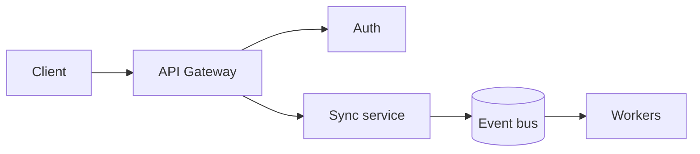

# Capacity Model

How many API nodes we need per region, and why. The model is deliberately simple: peak load, a headroom factor, and per-node throughput.

$$
N = \left\lceil \frac{R_{peak} \times h}{r_{node}} \right\rceil
$$

where $R_{peak}$ is peak requests per second, $h = 1.4$ is headroom, and $r_{node} \approx 2{,}500$ req/s.

> [!NOTE]
> Re-run this model whenever per-node throughput changes by more than 10%.

## Request path

## Current estimate

| Region | Peak req/s | Nodes |
| --- | ---: | ---: |
| us-east | 41,000 | 23 |
| eu-west | 18,500 | 11 |
| ap-south | 7,200 | 5 |
