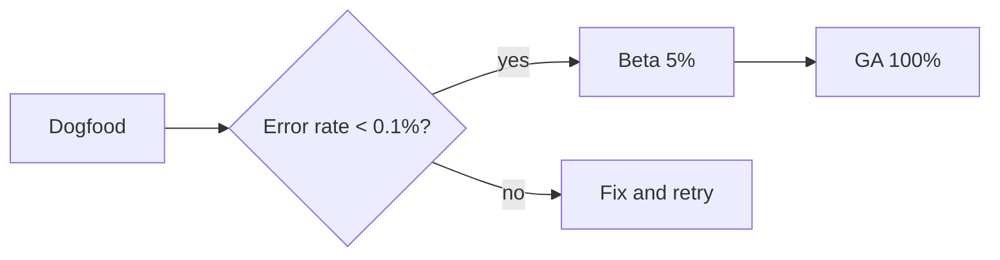

# Atlas 3.0 Launch Plan

Atlas 3.0 ships the **new sync engine**, *offline drafts* and a redesigned share sheet. This plan covers the rollout, the go/no-go checklist and how we measure success. Background on our release process is in the [Engineering Handbook](engineering-handbook.md). #launch

> [!TIP]
> Rollout is staged behind the `atlas-sync-v3` flag, so any step can be paused or rolled back in under five minutes.

## Milestones

| Phase | Audience | Date | Owner |
| --- | --- | --- | --- |
| Internal dogfood | Staff accounts | Oct 28 | Platform |
| Beta | 5% of workspaces | Nov 4 | Growth |
| General availability | Everyone | Nov 18 | Platform |

## Go / no-go checklist

- [x] Sync engine load test at 3× peak traffic
- [x] Migration dry run on a staging snapshot
- [x] Support macros and help center articles drafted
- [ ] Status page incident template updated
- [ ] Final sign-off from security review

## Rollout



## Success metric

We call the launch healthy when sync availability stays above target for the first two weeks:

$$
A = \frac{\text{successful syncs}}{\text{total syncs}} \geq 99.95\%
$$

> [!WARNING]
> Do not flip the flag to 100% on a Friday. Wait for the Monday window.

## Feature flag

```typescript
export const atlasSyncV3 = defineFlag({
  key: 'atlas-sync-v3',
  rollout: { beta: 0.05, ga: 1.0 },
  killSwitch: true,
});
```
