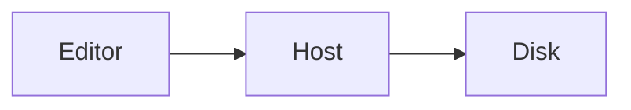

# MikeDown Desktop smoke fixture

This document exercises **bold**, *italic*, ~~strike~~, ==highlight==, `inline code`, a [link](https://example.com/docs) and an autolink <https://example.com>. Footnote reference.[^1]

> [!NOTE]
> Callouts render as GFM admonitions. This one has **bold** inside.

> [!WARNING]
> A second kind, to check the kind attribute survives.

## Lists

- Bullet one
- Bullet two
  - Nested bullet
- Bullet three

1. Ordered one
2. Ordered two

- [x] Task done
- [ ] Task open
  - [ ] Nested task

## Table

| Feature | WebKit | WebView2 |
| --- | :---: | ---: |
| Tables | yes | yes |
| Task lists | yes | yes |

## Code

```ts
export function greet(name: string): string {
  return `Hello, ${name}`;
}
```

```
plain fence
```

## Math

Inline math $a^2 + b^2 = c^2$ and a display block:

$$
\int_0^1 x^2 \, dx = \frac{1}{3}
$$

## Mermaid



## Image


## Misc

Line one with a hard break\
line two.

Horizontal rule below.

---

Emoji :tada: and a #tag at the end.

[^1]: The footnote text.
